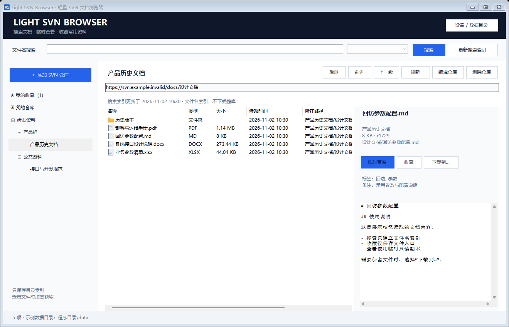

# Light SVN Browser

面向 Windows 的轻量 SVN 文档浏览器。多仓库按文件夹分组，支持文件名搜索、文件或文件夹收藏、标签备注、按需临时查看和主动下载。

## 启动

分发包解压后双击 **`LightSvnBrowser.exe`**。从源码使用时，先运行 `build.cmd` 或 `build.sh` 生成 EXE。正式构建为单个 EXE，内置 SVN 命令行客户端，无需另外安装 TortoiseSVN。

- 运行环境：64 位 Windows 10 / 11、.NET Framework 4.8。无需安装 Node、Java、数据库或 .NET SDK。
- EXE 约 4.6 MiB；首次运行将内置客户端解压到数据目录，占用约 9.4 MiB。
- 默认数据目录为 **EXE 所在目录的 `data` 子目录**。
- 数据目录不可写时明确报错，不会自动切换到 C 盘或用户 AppData。
- 初次启动不连接任何仓库；添加地址后，由你选择仓库开始访问。

## 使用

1. 点击“添加 SVN 仓库”，输入名称、仓库地址和登录信息。地址示例：`https://svn.example.invalid/docs`，请替换为自己的仓库地址。
2. “分组路径”填写 `研发资料/产品组` 等路径，可将多个地址组织成多级文件夹。编辑仓库即可调整分组。
3. 选择仓库查看远程目录，双击文件夹进入；“上一级”或 Backspace 返回。
4. 单击文本或图片会在右侧临时预览；双击文件或点“临时查看”打开只读临时副本。Word、Excel、PPT、PDF 等交给本机默认阅读程序。
5. 需要长期保留文件时点“下载到…”，自行选择保存位置。正式下载的副本可编辑，不会修改 SVN。
6. 选择文件或文件夹，点“收藏”或按 Ctrl+D，设置收藏名称、标签和备注。从“我的收藏”快速访问。
7. 顶部输入文件名关键词搜索，多个关键词用空格分隔；可选当前仓库、所有仓库或当前目录及子目录。在“我的收藏”中，搜索同时匹配名称、标签、备注和路径。
8. 从搜索结果进入目录后，点击“后退”或按 Alt+Left 返回原结果；“前进”或 Alt+Right 可再回目录。结果顺序、关键词、范围、选中项、滚动位置和列宽都会恢复，不重新访问 SVN。“上一级”仍表示父目录。

第一次搜索时，仅扫描所选仓库的目录元数据并建立文件名索引，**不 checkout、不读取全部文件正文**。首次扫描耗时取决于目录数量和网络；可随时取消。初版索引按需手动更新，SVN 有新增或修改后点击“更新搜索索引”。

重复搜索复用最近两个索引快照，并在后台完成加载和筛选；状态栏分别显示搜索及列表展示用时。搜索匹配总数会完整统计，最多显示排序后的前 5,000 项。前进/后退保留本次会话最近 30 个视图，显示历史时不发起新的 SVN 请求；需要最新目录内容时使用“刷新”。

收藏打开时重新读取文件的最新元数据；文件改名、移动或删除后可能失效，需要重新定位并收藏。收藏只保存入口，不复制原文件。

## 数据目录与缓存

程序管理的文件均放在选定的数据目录：

```text
data/
  settings.json           仓库、加密密码、收藏、标签备注及设置
  settings.json.bak       上一次成功保存的配置
  indexes/                文件名和路径索引，不存正文
  cache/                  按需获取的只读临时副本
  logs/                   有容量限制的诊断日志
  svn-config/             隔离的 SVN 配置，禁止额外缓存认证密码
  runtime/svn-1.14.1/     从 EXE 释放的客户端与第三方声明
  temp/                   程序和 SVN 子进程的临时目录
```

默认缓存上限 **256 MB**，保留 **7 天**，可在设置中调整。启动和读取文件时会清理过期或超额缓存；被外部软件锁定的文件可能暂时不能清理。临时查看单文件上限为 **64 MB**，且不超过配置的缓存上限；内嵌文本最多显示前 **2 MB**。大文件可主动下载，不受预览大小限制。

自定义目录有三种方式：

- 在“设置 / 数据目录”中更换。程序在新目录创建专用启动快捷方式并打开新窗口；新目录为空时复制仓库、收藏和设置，不复制缓存和索引。原目录保留；新目录已有配置时使用其中的配置。
- 使用启动参数：`LightSvnBrowser.exe --data-dir "<数据目录>"`，将占位符替换为实际目录。
- 给进程设置环境变量 `LIGHTSVNBROWSER_DATA_DIR=<数据目录>`；启动参数优先。

**更换后请通过新目录中的“启动 Light SVN Browser.lnk”启动。** 直接双击原 EXE 仍按默认规则使用旁边的 `data`。这种方式不需要在 C 盘、注册表或 EXE 旁另放一个自定义目录指针配置文件。相对路径以 EXE 所在目录为基准。

这里的目录约束针对本工具和它启动的 SVN 进程。Windows、自带文件选择器以及 Word、WPS、PDF 阅读器等外部软件管理自己的历史记录与缓存，不能由本工具统一控制。

## 登录与连接

- 仓库密码由 Windows DPAPI 按当前 Windows 账户加密；不以明文保存到配置、日志或命令行参数。
- 密码通过标准输入传给 SVN，独立的 SVN 配置目录禁用认证缓存。
- 数据文件复制到其他 Windows 账户或机器后，可能需要重新输入仓库密码。
- 支持 `https://`、`http://`、`svn://`、`file:///`；初版不支持 `svn+ssh`。
- 请求失败或认证失败后停止当前操作，没有自动重试或后台轮询。请核对账号、地址或证书后再手动操作。
- 默认严格校验证书。对必须使用 HTTPS IP 地址的仓库，可在“编辑仓库”中启用“允许 IP 地址与证书域名不一致（仅此仓库）”；只放行主机名不匹配，仍校验证书有效期和签发机构。此选项按仓库保存，其他仓库默认关闭；地址改成域名或非 HTTPS 时自动取消。
- 增强 SASL / Kerberos 认证的兼容性边界见 [第三方说明](THIRD-PARTY-NOTICES.md)。可在设置中指定其他兼容的 SVN 客户端；需要支持 `--password-from-stdin`（SVN 1.10+）。

## 构建和验证

使用 Windows 自带 .NET Framework C# 编译器，不需要 Maven、npm 或额外 SDK：

```powershell
.\build.cmd
.\package.cmd

# Git Bash / Cygwin / 开启 Windows 互操作的 WSL
bash ./build.sh
bash ./package.sh

# 也可直接调用 PowerShell
.\scripts\Build.ps1
.\scripts\Verify.ps1
```

`Build.ps1` 默认从本机 `C:\Program Files\TortoiseSVN\bin` 收集 SVN 命令行组件、必要依赖及许可声明，压缩嵌入 EXE。该目录是读取源，构建中间文件写入本项目的 `work/build`。可用 `-SvnBinDirectory` 指定来源；`-SkipRuntime` 可生成依赖本机 SVN 的更小构建。

更新运行中的应用时，可先使用 `Build.ps1 -OutputFile work/release/LightSvnBrowser.exe` 构建暂存版本，并用 `Verify.ps1 -ApplicationExecutable work/release/LightSvnBrowser.exe` 验证后再替换。

`package.cmd` / `package.sh` 默认构建并完成验证，然后生成 `dist/LightSvnBrowser-0.2.0-win-x64.zip`。包内使用明确的文件允许清单，不包含仓库配置、索引、日志或用户缓存。Windows 命令行使用 `.cmd`；`.sh` 调用 Windows PowerShell，不能在原生 Linux/macOS 上独立编译此 Windows 桌面程序。

可通过 `-RuntimeArchive <运行时ZIP>` 复用已有的合法客户端压缩包，或使用 `-SvnBinDirectory <SVN客户端目录>` 指定来源；`-SkipRuntime` 生成依赖本机 SVN 的小型版本。验证测试需要完整的本地 SVN 工具（包括 `svnadmin`、`svnserve`）；`-SkipVerify` 可以显式跳过验证，生成的包会提示未通过本次打包检查。

验证包含本地 SVN 仓库读写夹具、配置加密、索引与缓存、取消和失败处理、真实 WinForms 控件离屏测试及截图检查。自动化验证使用本地测试仓库和离线模拟响应，不会连接用户配置的远程仓库。测试与截图位于 `work`，不写入正式 `data`。

源码组织：`src/Core.cs` 为持久化及 SVN 访问，`SearchEngine.cs` 为后台文件名检索，`MainForm.cs` 为浏览、历史与搜索界面，`Dialogs.cs` 为仓库/收藏/设置对话框，`NativeRuntime.cs` 为客户端释放，`Program.cs` 为启动与数据目录处理。

## 初版范围

文件名搜索、目录浏览、收藏与临时查看均在本机执行，SVN 保持只读。暂不包含正文全文搜索、在线编辑提交、自动跟踪文件重命名、服务器权限管理或内置 Office 转换引擎。Markdown 按纯文本展示。

功能与验证范围见 [初版验证与改动说明](docs/初版验证与改动说明.md)。连接失败、证书名称不匹配等问题见 [故障排查](docs/TROUBLESHOOTING.md)。

搜索优化、历史导航与打包变化见 [版本记录](docs/RELEASE-NOTES.md)。

## 界面示例

下图使用虚构仓库和示例文件，不包含用户配置或真实仓库内容。


